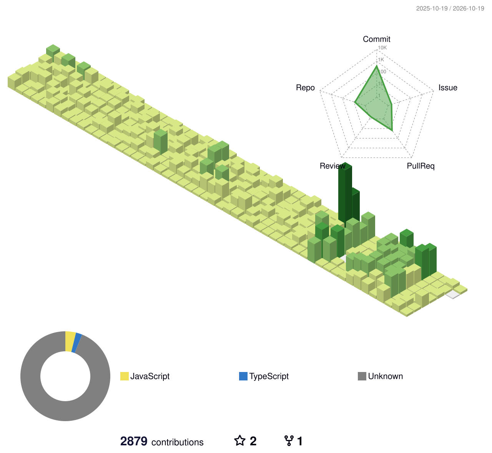

## HanCheol-Kim 

- **Software Engineer**   
- Like [Coffee, Listen Music]

## History   
- Oliveyoung Global Software Engineer (2024.06 ~ )  
- class101 Software Engineer (2021.12 ~ 2024.03)  
- Deepromeet - 10th FE (2021.09 ~ 2021.12)   
- 우아한형제들 - 우아한테크캠프 4기 FE intern (2021.07 ~ 2021.08)   

## Contribute

### Upstream open-source pull requests

Verified snapshot as of 2026-10-15. These 16 pull requests are authored in
third-party open-source projects (9 merged, 3 open, and 4 closed without
merging).

| Project | Pull request | State |
| --- | --- | --- |
| [Freelens](https://github.com/freelensapp/freelens) | [#776 — Add CPU and Memory usage metric column for pods view](https://github.com/freelensapp/freelens/pull/776) | Merged |
| [Freelens](https://github.com/freelensapp/freelens) | [#1556 — Fix CPU and Memory usage with LineProgress in pod list](https://github.com/freelensapp/freelens/pull/1556) | Merged |
| [Atlantis Helm Charts](https://github.com/runatlantis/helm-charts) | [#414 — Allow setting `portName` on service](https://github.com/runatlantis/helm-charts/pull/414) | Merged |
| [Bitnami Charts](https://github.com/bitnami/charts) | [#32969 — Fix annotations on the PostgreSQL passwordUpdateJob](https://github.com/bitnami/charts/pull/32969) | Merged |
| [OneUptime](https://github.com/OneUptime/oneuptime) | [#2521 — Simplify dashboard chart layout and spacing](https://github.com/OneUptime/oneuptime/pull/2521) | Merged |
| [OneUptime](https://github.com/OneUptime/oneuptime) | [#2528 — Load specs for volume autoscaler lists](https://github.com/OneUptime/oneuptime/pull/2528) | Merged |
| [OneUptime](https://github.com/OneUptime/oneuptime) | [#2542 — Improve metric and chart layout](https://github.com/OneUptime/oneuptime/pull/2542) | Merged |
| [OneUptime](https://github.com/OneUptime/oneuptime) | [#2544 — Preserve custom IN filter values in logs](https://github.com/OneUptime/oneuptime/pull/2544) | Merged |
| [OneUptime](https://github.com/OneUptime/oneuptime) | [#2446 — Fix policy-scoped on-call user overrides](https://github.com/OneUptime/oneuptime/pull/2446) | Closed (unmerged) |
| [OneUptime](https://github.com/OneUptime/oneuptime) | [#2534 — Add ClickHouse cold-tier and telemetry sharding support](https://github.com/OneUptime/oneuptime/pull/2534) | Closed (unmerged) |
| [OneUptime](https://github.com/OneUptime/oneuptime) | [#2572 — Improve first-page load performance](https://github.com/OneUptime/oneuptime/pull/2572) | Closed (unmerged) |
| [OneUptime](https://github.com/OneUptime/oneuptime) | [#3099 — Add native AWS Bedrock LLM provider](https://github.com/OneUptime/oneuptime/pull/3099) | Closed (unmerged) |
| [Percona PMM](https://github.com/percona/pmm) | [#5371 — Add RDS assume role support](https://github.com/percona/pmm/pull/5371) | Open |
| [Percona Grafana](https://github.com/percona/grafana) | [#901 — Add RDS assume role field](https://github.com/percona/grafana/pull/901) | Open |
| [Percona PMM submodules](https://github.com/Percona-Lab/pmm-submodules) | [#4357 — Build the RDS assume role feature](https://github.com/Percona-Lab/pmm-submodules/pull/4357) | Open |
| [Super Productivity](https://github.com/super-productivity/super-productivity) | [#8865 — Support multiple Google Calendar accounts](https://github.com/super-productivity/super-productivity/pull/8865) | Merged |

### Other open-source activity

Authored issues:

- [OneUptime #2445 — Policy-specific on-call user overrides leak across policies](https://github.com/OneUptime/oneuptime/issues/2445) (closed)
- [OneUptime #2529 — RFC: iOS Critical Alerts for mobile push notifications](https://github.com/OneUptime/oneuptime/issues/2529) (closed)

Issue and pull-request discussions, separate from authored work above:

- [Argo CD #24876](https://github.com/argoproj/argo-cd/issues/24876) — EKS authentication troubleshooting
- [Kotlin Language Server #72](https://github.com/fwcd/kotlin-language-server/issues/72) — compiler configuration workaround
- [Terragrunt #1487](https://github.com/gruntwork-io/terragrunt/issues/1487) — dependency-output workaround
- [Freelens #743](https://github.com/freelensapp/freelens/issues/743) — pod metrics discussion
- [Freelens #851](https://github.com/freelensapp/freelens/issues/851) — pod metrics discussion
- [Freelens PR #786 review](https://github.com/freelensapp/freelens/pull/786) — memory-unit and display review
- [Percona PMM #3215](https://github.com/percona/pmm/issues/3215) — RDS/IAM feature discussion
- [OneUptime #2511](https://github.com/OneUptime/oneuptime/issues/2511) — critical alerts discussion

Personal open-source projects (separate from upstream contributions)

- [lite-queen #1](https://github.com/HanCheo/lite-queen/pull/1) and [#2](https://github.com/HanCheo/lite-queen/pull/2) (merged); [#3](https://github.com/HanCheo/lite-queen/pull/3) (closed, unmerged)
- [atlnatis-helm-charts #1](https://github.com/HanCheo/atlnatis-helm-charts/pull/1) (merged; related upstream change is [runatlantis/helm-charts #414](https://github.com/runatlantis/helm-charts/pull/414), counted only above)
- [mobilog](https://github.com/HanCheo/mobilog) (MIT personal project)

## 3D contribution language chart

<picture>
  <source media="(prefers-color-scheme: dark)" srcset="profile-3d-contrib/profile-night-rainbow.svg">
  <source media="(prefers-color-scheme: light)" srcset="profile-3d-contrib/profile-green.svg">
  
</picture>

Chart labels represent each repository's primary language in GitHub's
contribution data, not the languages in files changed by the author.

Chart methodology

The scheduled workflow renders every repository-primary language returned by
GitHub's `commitContributionsByRepository` data; no top-five language cap is
applied.

Commits from repositories without language data (or outside the returned
repository window) remain visible as `Unknown`. The language legend uses
multiple columns in a dedicated panel below the calendar for full charts, and
the pie-only/full canvas expands vertically as needed so low-share languages
remain readable. The generator's contribution-repository query remains
limited to GitHub's 100 returned repositories, while `MAX_REPOS` controls
separate fork/star stats. The calendar and commit totals are GitHub's current
contribution window.

